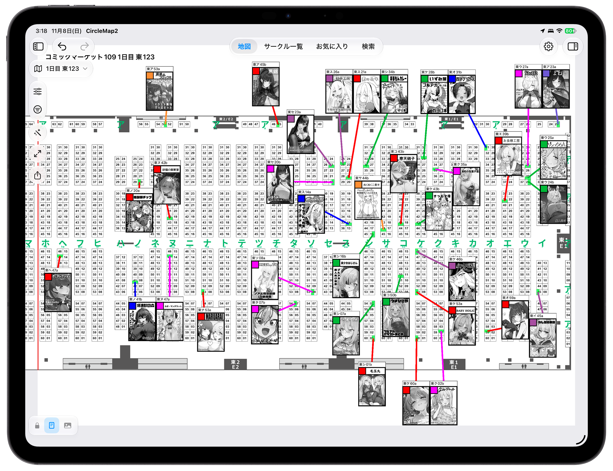
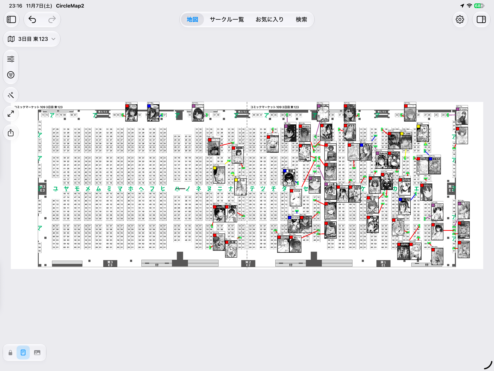
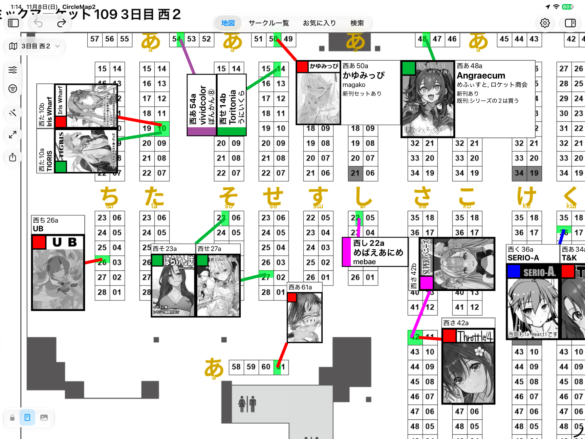
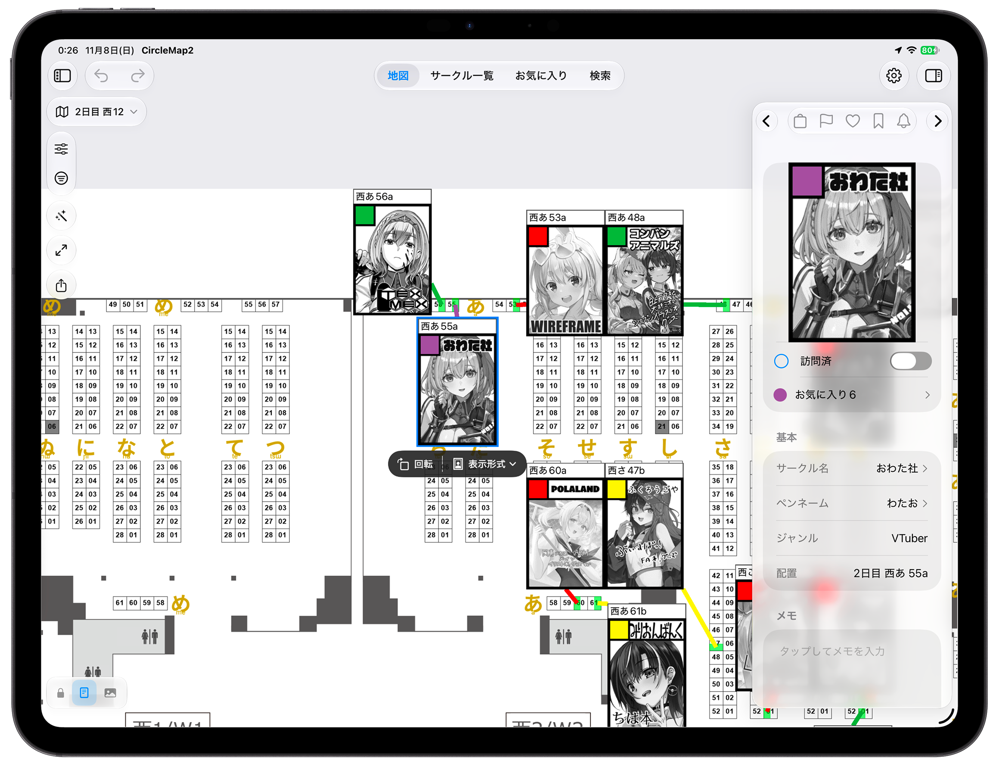
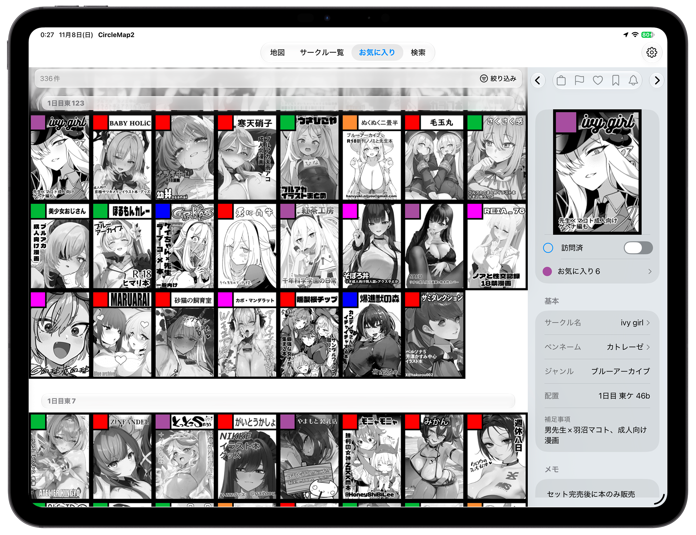
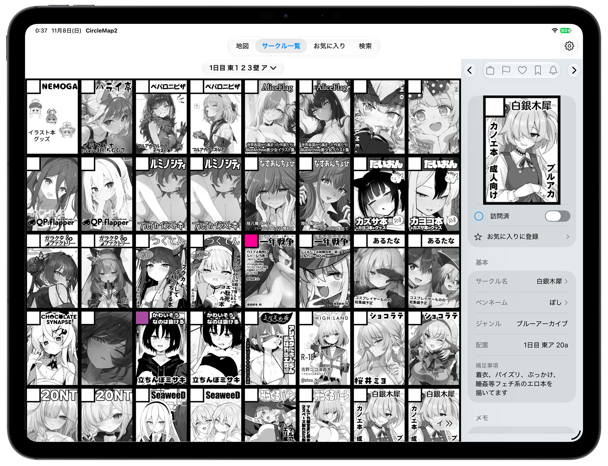

# CircleMap2
最高の地図でコミケに挑もう！

[CircleMap](/circlemap/)の後継アプリとして、さらに見やすく・使いやすく進化しました。コミケ歴1X年の作者が考えた**理想のコミケアプリ**。Webカタログの印刷機能の不満をこれで解消！
チェックサークルが多いほど公式の地図では見づらくなってしまいますが、CircleMap2なら見やすい地図が作れます。

  <a class="btn primary" href="#store">ダウンロードはこちら</a>
  <a class="btn" href="#features">機能一覧を見る</a>

---

## このアプリでできること {#features}

- ✅ **開くだけで自動配置**
  - 地図を開くと、お気に入りサークルが自動で並びます。あとは気になるところを手直しするだけ。
- ✅ **自由に配置できる**
  - サークルや地図を自由に移動できるので思い通りのレイアウトが作成可能。線がごちゃごちゃして見づらい地図からワンランク上の地図が作れます。
- ✅ **元に戻す・やり直し**
  - 配置の操作は取り消し・やり直しができるので、思い切って並べ替えられます。
- ✅ **様々な地図が作れる**
  - サークルの表示を複数用意。線の太さや用紙サイズなどの細かい設定であなたの地図作りをサポートします。
- ✅ **地図を画像に保存できる**
  - 作った地図は印刷に最適なサイズの画像として保存できるので、紙の地図も綺麗に印刷して会場に持ち出せます。
- ✅ **サークル情報をすぐ確認**
  - 地図からサークルの詳細を確認したり、お気に入りやサークル一覧から目当てのサークルを探したりできます。
- ✅ **スタンプ・訪問済みマーク**
  - サークルに5種類のスタンプや訪問済みマークを付けられます。地図にも表示されるので、当日の回り忘れを防げます。
- ✅ **お気に入り18色に対応**
  - Webカタログのお気に入り18色に対応。地図に表示する色を選んで、日程や目的ごとに地図を作り分けられます。
- ✅ **カタログチェック連携**
  - アプリから直接pixiv / Xの起動が可能。チェック作業がはかどります。
- ✅ **チェックリスト連携**
  - Webカタログでつくったチェックリストを取り込んで地図作成、という流れにも対応。

---

## レイアウト

地図は東123のようなホール全体や、東1の1ホール単位の表示が可能。重点的に攻めるホールがある場合に便利です。

### 開くだけで自動配置
ホールを選んで地図を開くと、お気に入りサークルが配置済みの状態で表示されます。手直しで崩れたときは、ツールの「サークルを自動配置」でいつでも並べ直せます（回転や表示形式はそのまま）。

<!-- TODO: 自動配置の画像 -->

### 用紙を分割して配置
用紙は A3・B4・A4・B5 の縦横から選べます。広いホールも用紙単位で分割して配置できるので、1枚に収まりきらない大きな地図も印刷しやすいサイズに分けて出力できます。地図を大きく印刷できる分、サークルの配置にゆとりが生まれて見やすい地図に仕上がります。

### 表示形式を混在＋90度回転
サークルの表示形式は、カットの大きさ違いやカット＋サークル名、詳細、1行表示など8種類。地図全体の表示形式を決めたうえで、サークルごとに個別に変えられます。絶対に行きたいサークルはカットを大きく、それ以外は小さく、といった地図が作れます。
90度回転もできるので、密集した島もすっきり収められます。

### 線がカードの角から伸びる
ホール上のスペースからサークルへ伸びる線は、太さを選べます。線が伸びている辺にサークルをくっつけて置くと、線がカードの角から伸びるので、密集した場所でもどのサークルの線か追いやすくなります。

<!-- TODO: 線が角から伸びる画像 -->

### 地図上にジャンルを表示
ホールの地図にジャンルを重ねて表示できます。透明度も調整できるので、どのあたりにどんなジャンルが集まっているのかを見ながら地図を作れます。

<!-- TODO: ジャンル表示の画像 -->

---

## サークルを探す・確認する

### タップしてサークル詳細を確認
地図上のサークルカットをタップするだけで、サークル名・ペンネーム・ジャンル・配置・補足事項などの詳細をその場で確認できます。

### お気に入りを一覧でチェック
チェックしたサークルを日程・ホールごとにまとめて一覧表示。会場を回る前の最終確認にも便利です。

### サークル一覧で絞り込み
壁・ブロックなど単位を絞り込んでサークルを一覧表示。目当てのサークルをすばやく探せます。

---

## 利用に必要なもの {#requirements}

- **コミックマーケットWebカタログの有料会員アカウント（WebカタログGold / Circle.ms）**
  - カタログデータの取得に利用します
- **iPad（iPadOS 26.1以上）**
  - iPhone・Macには対応していません
- インターネット接続
  - 最初のセットアップで約600MBのデータをダウンロードします。Wi-Fiでのご利用をおすすめします

アカウントがなくても、アプリ内のサンプルデータで操作を試せます。

---

## CircleMapをお持ちの方へ {#upgrade}

[CircleMap](/circlemap/)を購入済みの方は、「CircleMap アップグレードパック」から購入すると、パック価格からCircleMapの購入金額を差し引いた価格でCircleMap2を入手できます（900円で購入された方は400円）。

  <a class="btn" href="https://apps.apple.com/jp/app-bundle/id6832071505" target="_blank" rel="noopener">アップグレードパックを見る</a>

- CircleMapを購入したときと同じApple IDでご購入ください
- 差額は購入時期によって異なります。購入前にApp Storeの表示価格をご確認ください
- 今お使いのCircleMapも、引き続きそのまま使えます（お気に入り色は9色まで）

---

## ダウンロード {#store}

  <a class="btn primary" href="https://apps.apple.com/jp/app/circlemap2/id6796397015" target="_blank" rel="noopener">App Storeで入手</a>

※iPad用アプリ。ご利用には[WebカタログGold会員](#requirements)が必要です。

---

## Macならこちら

Macでカタログチェックをするなら [CircleScope](/circleScope/) がおすすめ。コミケWebカタログをMacの大きな画面でサクサク整理できる閲覧支援アプリです。事前チェックはMacで、地図づくりはiPadで、という使い分けもできます。

---

## お問い合わせ

使い方は[使い方ガイド](/circlemap2/guide/)、困ったときは[よくある質問](/circlemap2/faq/)をご覧ください。
ご意見・バグ報告などは[サポートページ](/circlemap2/support/)からお願いします。
