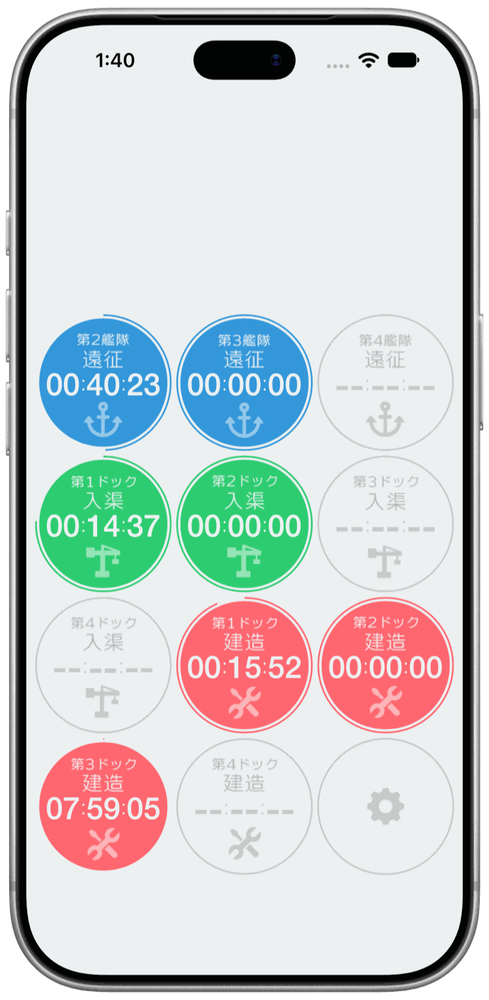

  

    

      
      <h1 class="kt-hero__title">艦隊たいまー</h1>
      
艦これ<small>の</small>待ち時間<small>を</small>一括管理

      
    

    

      
    

  

## このアプリでできること {#features}







---

## ダウンロード {#store}

---

## サポート

ご意見・バグなどは[こちらのフォーム](https://docs.google.com/forms/d/e/1FAIpQLSdOeNdTRjGcAoQMHkb81oYGBQm2uUeBdLIOqsXURd2MPtk1yQ/viewform?usp=sf_link){:target="_blank" rel="noopener"}へお寄せください。
